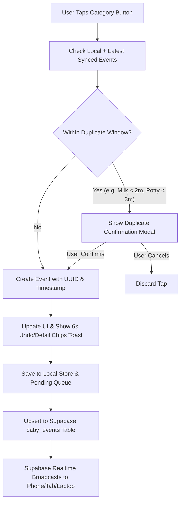

# Baby Monitor 1-Tap PWA Plan

## 1. Architecture & Multi-Terminal Sync Flow

The application will be a Progressive Web App (PWA) built with **Vite + React + TypeScript + Tailwind CSS** and **Supabase** (Postgres + Realtime) with an **Offline-First Sync Engine** (local storage + queue + cross-tab `BroadcastChannel` fallback so the app also works immediately before Supabase keys are configured).

## 2. Database Schema & Authentication (`Baby ID` + `Password`)

We will provide a complete SQL setup script in `[supabase/schema.sql](supabase/schema.sql)` with two core tables:

- **`babies` table**:
  - `baby_id` (text, primary key, normalized lowercase slug such as `leo-2026`)
  - `baby_name` (text, display name)
  - `password_hash` (text, SHA-256 salted hash computed via Web Crypto API)
  - `created_at` (timestamptz)
- **`baby_events` table**:
  - `id` (uuid, primary key, client-generated so offline logs are idempotent)
  - `baby_id` (text, foreign key to `babies.baby_id`, indexed)
  - `type` (text: `'milk' | 'urine' | 'potty' | 'both' | 'sleep_start' | 'sleep_end' | 'medicine'`)
  - `timestamp` (timestamptz, defaults to `now()`, supports backdated timestamps)
  - `details` (jsonb, optional quick chips such as `{ "amount_ml": 90, "note": "Bottle" }`)
  - `device_label` (text, e.g. `"Phone"`, `"Tablet"`, `"Laptop"`)
  - `created_at` (timestamptz)

### Authentication Flow (`[src/services/auth.ts](src/services/auth.ts)`)
- **Login Mode**: Enter `Baby ID` and `Password`. Verifies against the `babies` table (or local store when in offline/demo mode) and persists the session locally.
- **Create Profile Mode**: Register a new `Baby ID`, `Baby Name`, and `Password` directly from the login screen so parents can set up a baby profile immediately and log in with the same credentials on other devices.

## 3. Duplicate-Guard Cooldown Rules (`[src/utils/cooldown.ts](src/utils/cooldown.ts)`)

Before registering any immediate tap, the app checks the most recent matching event for that `baby_id`:

- **Milk**: `2 minutes` (`120,000 ms`) since the last `'milk'` entry.
- **Urine**: `2 minutes` (`120,000 ms`) since the last `'urine'` or `'both'` entry.
- **Potty**: `3 minutes` (`180,000 ms`) since the last `'potty'` or `'both'` entry.
- **Both (Urine + Potty)**: Triggers confirmation if either a `'urine'`/`'both'` entry was logged within `2 minutes` OR a `'potty'`/`'both'` entry was logged within `3 minutes`.
- **Medicine / Vitamins**: `30 minutes` (`1,800,000 ms`) since the last `'medicine'` entry to prevent accidental double-dosing across caregivers.
- **Sleep / Nap Toggle**: `2 minutes` (`120,000 ms`) since the last `'sleep_start'` or `'sleep_end'` transition.

When triggered, `[src/components/DuplicateConfirmModal.tsx](src/components/DuplicateConfirmModal.tsx)` displays:
- Exact elapsed time since the previous entry (e.g., *"Milk was logged 42 seconds ago at 10:14 AM"*).
- Which device logged it (if available).
- Prominent **Cancel** button (default safe action) and **Yes, Log Again** button.

## 4. Ergonomic 1-Tap UI & Features (Uncluttered Design)

### Header Bar (`[src/components/Header.tsx](src/components/Header.tsx)`)
- Displays Baby Name & `Baby ID` badge.
- **Sync Status Pill**: Shows `Synced`, `Syncing...`, or `Offline (X queued)` with a manual refresh tap target.
- **3 AM Night Mode Toggle**: Switches to a low-glare, deep warm amber-on-black theme (`[src/index.css](src/index.css)`) designed not to wake the baby in a dark room.
- **Account Switch / Logout** button.

### Main 1-Tap Action Grid (`[src/components/ActionGrid.tsx](src/components/ActionGrid.tsx)`)
- Large, thumb-friendly 2-column grid of 6 action cards:
  - **Milk**
  - **Urine**
  - **Potty**
  - **Both (Urine + Potty)** — counts toward both wet and dirty diaper totals and updates both timers
  - **Sleep / Wake Toggle** — shows active sleep duration timer when sleeping, or time since woke up when awake
  - **Medicine / Vitamins**
- Each button displays:
  - Clear icon and label.
  - **Live "Time Since Last" badge** (e.g., `1h 45m ago`, auto-updating every 15 seconds).
  - **Today's Count badge** (e.g., `5 today`).

### Post-Tap Undo & Optional Detail Chips Toast (`[src/components/PostLogToast.tsx](src/components/PostLogToast.tsx)`)
- Appears at the bottom of the screen for 6 seconds immediately after logging an event.
- **Undo button**: 1 tap removes the entry if tapped by mistake.
- **Quick-Tap Chips** (completely optional, zero typing required):
  - Milk: `60ml`, `90ml`, `120ml`, `150ml`, `Breast L`, `Breast R`
  - Urine / Potty / Both: `Light`, `Medium`, `Heavy`
  - Medicine: `Vit D`, `Drops`, `Fever Med`
  - Sleep: `Crib`, `Contact Nap`

### Backdate Entry Sheet (`[src/components/BackdateModal.tsx](src/components/BackdateModal.tsx)`)
- Single subtle `"Log past time (+15m / custom)"` button below the main grid.
- Lets parents pick `-10m`, `-15m`, `-30m`, `-1h`, or a custom time picker, then tap the category.

### Daily Summary & History View (`[src/components/SummaryHistory.tsx](src/components/SummaryHistory.tsx)`)
- Accessible via a clean 2-tab bottom switcher (`Log` | `History & Summary`).
- **Daily Summary Cards**: Total Milk feeds (plus total ml logged), Wet Diaper count (`Urine + Both`), Dirty Diaper count (`Potty + Both`), Total Sleep time, Medicine count, and average feeding interval.
- **Activity Timeline**: Filterable by day, showing exact timestamps, optional details, device source, and delete button.

## 5. Multi-Terminal Sync & PWA Configuration

- **Auto-Sync on Open (`[src/services/syncEngine.ts](src/services/syncEngine.ts)`)**:
  - Fetches latest events immediately on app mount, `window` `focus`, `document` `visibilitychange` (whenever the PWA is opened from home screen), and `online` network restoration.
  - Subscribes to Supabase Realtime changes on `baby_events` filtered by `baby_id` so open phones, tablets, and laptops update live within milliseconds.
  - Queues offline writes in `localStorage` and flushes them automatically via `upsert` when connectivity returns.
- **PWA Setup (`[vite.config.ts](vite.config.ts)` & `[public/manifest.webmanifest](public/manifest.webmanifest)`)**:
  - Configured with `vite-plugin-pwa` for standalone mobile home-screen installation, offline asset caching, and custom app icons.

## 6. Key Files to Create

- `[package.json](package.json)`, `[vite.config.ts](vite.config.ts)`, `[tsconfig.json](tsconfig.json)`, `[index.html](index.html)`
- `[supabase/schema.sql](supabase/schema.sql)` — Postgres tables, indexes, and RLS policies for Supabase.
- `[.env.example](.env.example)` — Template for `VITE_SUPABASE_URL` and `VITE_SUPABASE_ANON_KEY`.
- `[src/types.ts](src/types.ts)` — Data models for `BabyProfile`, `BabyEvent`, `EventType`, and cooldown rules.
- `[src/utils/cooldown.ts](src/utils/cooldown.ts)` — Duplicate detection logic (2m Milk, 2m Urine, 3m Potty, 3m Both, 30m Medicine, 2m Sleep) and human-readable duration formatters.
- `[src/services/supabaseClient.ts](src/services/supabaseClient.ts)` — Supabase client initialization and connection detector.
- `[src/services/auth.ts](src/services/auth.ts)` — `Baby ID` + `Password` hashing, login, and profile creation.
- `[src/services/syncEngine.ts](src/services/syncEngine.ts)` — Offline-first storage, queue flushing, visibility/focus sync triggers, and Realtime subscription.
- `[src/components/AuthScreen.tsx](src/components/AuthScreen.tsx)` — Baby ID & Password login / profile creation view.
- `[src/components/Header.tsx](src/components/Header.tsx)` — Baby badge, sync status indicator, and 3 AM Night Mode toggle.
- `[src/components/ActionGrid.tsx](src/components/ActionGrid.tsx)` — 1-tap logging buttons with live timers and daily counters.
- `[src/components/DuplicateConfirmModal.tsx](src/components/DuplicateConfirmModal.tsx)` — Safety confirmation prompt when within duplicate time window.
- `[src/components/PostLogToast.tsx](src/components/PostLogToast.tsx)` — Non-blocking Undo + quick detail chips bar.
- `[src/components/BackdateModal.tsx](src/components/BackdateModal.tsx)` — Quick backdate logging (`15m ago`, `30m ago`, custom time).
- `[src/components/SummaryHistory.tsx](src/components/SummaryHistory.tsx)` — Pediatrician-friendly daily totals and chronological log history.
- `[src/App.tsx](src/App.tsx)` — Main layout, state orchestration, and tab navigation.